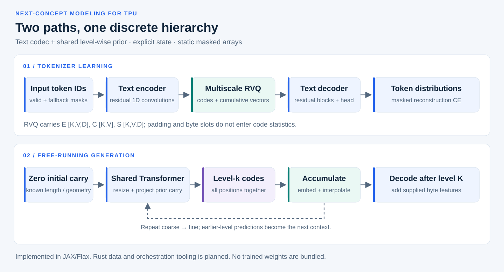
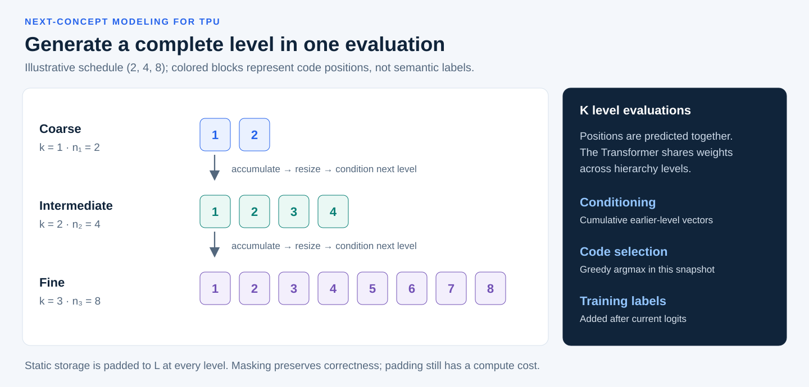
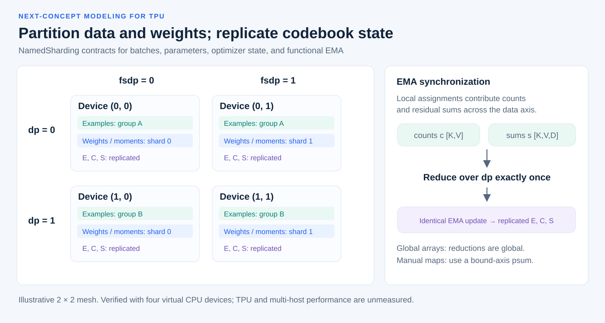

<div align="center">

# Next-Concept Modeling for TPU

**A functional JAX/Flax implementation of hierarchical text codes and parallel coarse-to-fine generation.**

[](pyproject.toml)
[](#installation)
[](LICENSE)
[](#evidence-and-current-status)

**Project and manuscript author: Fabian Balensiefer**

[Research paper · PDF](output/pdf/ncm_systems_paper.pdf) · [LaTeX source](paper/ncm_systems_paper.tex) · [Quick start](#quick-start) · [Scientific references](#references)

</div>



## Project description

This repository implements the neural core of an unnamed, TPU-oriented adaptation of **Next-Concept Modeling (NCM)**. A text encoder produces a continuous sequence representation; a multiscale residual vector quantizer represents it with discrete codes; a shared Transformer predicts the hierarchy from coarse to fine; and a text decoder reconstructs token distributions. Every position in a level is predicted together, conditioned on the cumulative representation of earlier levels.

The underlying NCM method is due to **Kumbong et al.** [1]. This project focuses on an explicit execution contract: functional codebook state, padding-safe statistics, static level scans, and declared data/model sharding. It also implements project-specific entropy and concept-consistency objectives, a runtime codebook-freezing phase, and byte-feature routing. These choices should be evaluated independently of the published NCM recipe. `tpu-ncm` is the package identifier, not a separate model name.

The intended systems boundary is **JAX/Flax/XLA for accelerator-resident neural computation** [5,6], with **Rust planned for corpus preparation, input validation, orchestration, and evaluation tooling**. The current repository contains the Python neural implementation; Rust tooling is future work. Vector quantization and straight-through learning build on the VQ-VAE lineage [2]; residual quantization and structured quantizer dropout also appear in neural codecs such as SoundStream [3]. The shared prior uses Transformer attention [4].

## Research paper

> **Fabian Balensiefer.** *A Functional JAX/Flax Implementation of Next-Concept Modeling for TPU-Oriented Execution.* November 11, 2026.

- **[Read the paper (PDF)](output/pdf/ncm_systems_paper.pdf)** — formulation, architecture, distributed execution, software validation, limitations, and research plan.
- **[Download the self-contained LaTeX source](paper/ncm_systems_paper.tex)** — references and the vector architecture figure are embedded.
- **[Reproduction notes](paper/README.md)**, **[validation metadata](paper/validation.json)**, and **[source hashes](paper/source_manifest.sha256)** accompany the manuscript.

This is a systems implementation paper with software correctness evidence. It does not report corpus-trained language-model quality or measured TPU performance.

## Contents

- [Evidence and current status](#evidence-and-current-status)
- [Architecture and scientific formulation](#architecture-and-scientific-formulation)
- [Training objectives and gradient flow](#training-objectives-and-gradient-flow)
- [Installation](#installation)
- [Quick start](#quick-start)
- [Parallel generation](#parallel-generation)
- [Distributed execution](#distributed-execution)
- [Byte fallback contract](#byte-fallback-contract)
- [Validation and reproducibility](#validation-and-reproducibility)
- [Repository structure](#repository-structure)
- [Limitations and research roadmap](#limitations-and-research-roadmap)
- [Citation](#citation)
- [References](#references)

## Evidence and current status

| Component or claim | Status | Scope of evidence |
| --- | --- | --- |
| Multiscale residual VQ | Implemented | Nearest-neighbor, residual, mask, and gradient tests |
| Functional EMA codebooks | Implemented | Equation checks, runtime freezing, empty-level preservation |
| Shared level-wise Transformer | Implemented | Earlier-level conditioning and current/future-label isolation tests |
| Combined training objective | Implemented | Reconstruction, commitment, soft marginal entropy, optional concept consistency, prior CE |
| Byte fallback routing | Implemented | Fixed-shape embedding selection and exclusion from learned code statistics |
| `dp` / `fsdp` placement | Implemented | Four virtual CPU devices, a 2 × 2 mesh, and a global reference comparison |
| Automated tests | **11 passing CPU tests** | Local validation, not a hosted CI or performance claim |
| Synthetic training example | Executed | Three small steps, including a phase switch |
| TPU execution and multi-host scaling | **Unmeasured** | Requires target hardware and profiling |
| Model quality or 99.5% exact-match target | **Not established** | No trained checkpoints or held-out corpus evaluation |
| Complete lossless byte codec | Planned integration | Byte expansion, serialization, and literal reassembly remain external |
| Rust pipeline / checkpoint lifecycle | Planned | No implementation or benchmark included |

The virtual CPU mesh checks distributed array semantics. It does not reproduce a TPU's memory system, interconnect, compilation behavior, or throughput.

## Architecture and scientific formulation

### 1. Static multiscale representation

For batch size $B$, canonical sequence length $L$, latent dimension $D$, codebook size $V$, and $K$ levels, configure

$$
1 \le n_1 \le \cdots \le n_K = L.
$$

Each compiled bucket fixes $B$, $K$, $L$, $D$, $V$, and the full length tuple. The logical code sequence at level $k$ has length $n_k$; common storage has shape `[K, B, L]`. Structural masks exclude positions beyond $n_k$, and invalid code indices are `-1`.

**Mask convention:** `True` means **valid**, including arguments named `padding_mask`. Padding and fallback slots are excluded from the learned encoder inputs and quantizer statistics. Code IDs are distinct from input vocabulary IDs.

### 2. Mask-aware residual quantization

Let $z$ be the encoder output and $\hat z^{(0)}=0$. Area pooling maps the common-grid residual to level $k$; linear interpolation maps its quantized contribution back:

$$
u_k = \operatorname{Down}_k\!\left(z-\operatorname{sg}[\hat z^{(k-1)}]\right),
\qquad
i_{kbt}=\arg\min_v \|u_{kbt}-E_{kv}\|_2^2.
$$

$$
q_{kbt}=E_{k,i_{kbt}},
\qquad
\hat z^{(k)}=\hat z^{(k-1)}+\operatorname{Up}_k(q_k).
$$

Both resampling operators normalize by the mass of valid source positions. They support non-divisible lengths and prevent padding values from contaminating valid outputs. Contributions are also masked on the canonical grid. Reconstruction uses the straight-through representation

$$
z_{\mathrm{ST}}=z+\operatorname{sg}[\hat z^{(K)}-z].
$$

`sg` denotes stop-gradient. Codebook embeddings are updated by EMA rather than by the neural optimizer. The text codec uses one-dimensional residual convolution blocks; the hierarchy does not by itself prove that learned codes are interpretable semantic concepts.

### 3. Explicit EMA state

The complete codebook state travels through compiled training steps:

| Tensor | Shape | Meaning |
| --- | --- | --- |
| `embeddings` / $E$ | `[K, V, D]` | Codebook vectors |
| `counts` / $C$ | `[K, V]` | Smoothed assignment counts |
| `sums` / $S$ | `[K, V, D]` | Smoothed residual sums |

For globally aggregated batch counts $c$ and residual sums $s$:

$$
C' = \gamma C+(1-\gamma)c,
\qquad
S' = \gamma S+(1-\gamma)s,
\qquad
E' = \frac{S'}{C'+\epsilon}.
$$

Default decay is `0.99` and smoothing is `1e-5`. Initialization uses unit pseudo-counts. An empty level retains its complete old state. Hard counts and sums use scatter accumulation; distance and soft-assignment tensors are still dense.

### 4. Level-wise parallel prediction



Before predicting level $k$, the shared Transformer resizes and projects **only the cumulative representation from earlier levels**, then adds level and position embeddings. It predicts the whole level's logits in one evaluation. Valid target-free position queries may attend bidirectionally within that level.

During teacher forcing, current-level target vectors enter the carry **after** the current logits have been computed. During free-running generation, greedy predicted vectors enter the carry. Thus generation has $K$ sequential level evaluations; there is no within-level token-autoregressive loop.

The generator also scans levels during training. It does not implement the original work's concatenated all-level training call, conditioning corruption, pretrained weights, or full experimental recipe [1].

## Training objectives and gradient flow

The joint objective is

$$
\mathcal L = \mathcal L_{\mathrm{recon}}
+\beta\mathcal L_{\mathrm{commit}}
+\lambda_H\mathcal L_H
+\lambda_C\mathcal L_{\mathrm{concept}}
+\lambda_{\mathrm{prior}}\mathcal L_{\mathrm{prior}}.
$$

| Term | Implementation | Default coefficient |
| --- | --- | --- |
| Reconstruction | Token cross-entropy over valid input positions, including byte-routed content | `1.0` |
| Commitment | Squared residual-to-quantized distance, averaged over valid scalar components | `beta=0.25` |
| Hierarchical entropy | Negative marginal entropy from differentiable soft distance assignments | `entropy=0.01` |
| Concept consistency | Cosine distance between aligned coarse vectors and a learned projection of the completed representation | `concept=0.0` |
| Prior | Teacher-forced CE against aligned next-level code targets | `prior=1.0` |

Entropy defaults to coarse-to-fine weights $(K,\ldots,1)$ and temperature `1.0`. Hard argmin histograms have zero encoder gradient almost everywhere, so the regularizer uses soft assignments. Hard counts remain the basis for EMA, usage, and perplexity. Higher soft marginal entropy is not sufficient evidence of better hard-code diversity or useful semantics.

The NCM prior uses **aligned code targets at the next hierarchy level**. Shifting these targets one position within a level would change the objective. A separate `next_token_cross_entropy` helper exists for an optional token-causal decoder; it is not used as the level-wise prior loss.

| Path | Receives gradients? |
| --- | --- |
| Encoder from reconstruction | Yes, through the straight-through estimator |
| Encoder from commitment / soft entropy | Yes |
| Projection and encoder from optional concept loss | Yes through the fine-feature path; the hard coarse-code path is non-differentiable |
| Generator from prior CE | Yes |
| Encoder through prior code identities | No; hard targets and codebook gathers are stop-gradient |
| Codebook $E,C,S$ through optimizer | No; updated functionally by EMA |

The provided optimizer interface trains codec and generator parameters together. Because the codec changes, the prior sees moving targets. A separately frozen-tokenizer prior stage remains an important experimental comparison.

### Runtime phases and quantizer dropout

Pass a scalar integer JAX array as `phase`:

- **`phase == 0`:** all nonempty levels are eligible for EMA. If configured, per-example nested dropout retains a uniformly sampled prefix with probability `nested_dropout`.
- **`phase != 0`:** codebooks at levels $1$ through $K-2$ preserve **all** of $E,C,S$; the final two remain eligible. Nested dropout is disabled dynamically.
- With $K\le2$, the final phase freezes no codebooks. It does not freeze encoder or decoder parameters.
- An all-padding global batch preserves parameters, optimizer state, codebooks, and the step counter.

The phase is a runtime predicate, so switching its value does not require a different shape-specialized executable.

## Installation

Python **3.12** is the tested development environment; the package declares Python `>=3.11`. Install a compatible JAX runtime for the target platform. The current package range is `jax>=0.8.0,<0.11`, `flax>=0.12,<0.13`, and `optax>=0.2.6,<0.3`; the code uses **Flax Linen**.

### CPU development

```bash
git clone https://github.com/fbalensiefer/Next-Concept-Modeling-for-TPU.git
cd Next-Concept-Modeling-for-TPU
python3.12 -m venv .venv
source .venv/bin/activate
python -m pip install -e '.[test]'
```

For closer reproduction of the validated stack:

```bash
python -m pip install 'jax==0.10.2' 'jaxlib==0.10.2' \
  'flax==0.12.8' 'optax==0.2.8' 'numpy==2.5.4'
```

### TPU deployment preparation

Follow the [official JAX installation guide](https://docs.jax.dev/en/latest/installation.html) for the TPU image and runtime, selecting a version compatible with this project's declared range. Install this package afterward and verify both the resolved versions and `jax.devices()` before training. Initializing distributed JAX must precede mesh creation on multiple hosts. TPU installation and execution are not part of the current validation evidence.

## Quick start

Run the complete correctness suite and the small training example:

```bash
python -m pytest -q
python examples/train.py
```

The example uses `(n_1,n_2,n_3)=(2,4,8)`, `B=2`, `D=16`, `V=16`, and a two-block Transformer with width 32. It runs three synthetic steps and switches phase on the third. Its default mesh assumes a device count that divides the batch; use one CPU device for the documented smoke run.

### Minimal tokenizer use

```python
import jax
import jax.numpy as jnp
from ncm import RVQConfig, MultiscaleTokenizer, init_codebooks

config = RVQConfig(lengths=(2, 4, 8), codebook_size=16, dim=16)
codebooks = init_codebooks(jax.random.key(0), config)
tokenizer = MultiscaleTokenizer(config, token_vocab_size=256)

tokens = jnp.arange(8, dtype=jnp.int32)[None, :]
valid = jnp.ones_like(tokens, dtype=bool)
byte_ids = jnp.zeros_like(tokens)
fallback = jnp.zeros_like(valid)
args = (tokens, valid, byte_ids, fallback, codebooks)
variables = tokenizer.init(jax.random.key(1), *args)
output = jax.jit(tokenizer.apply)(variables, *args)

assert output.rvq.indices.shape == (3, 1, 8)
assert output.logits.shape == (1, 8, 256)
# Logical level k: output.rvq.indices[k, :, :config.lengths[k]]
```

This initializes random weights for an API/shape check. Meaningful reconstruction and generation require training.

## Parallel generation

`SharedLevelGenerator` accepts explicit codebook state, level masks `[K,B,L]`, and fixed-shape target storage. With `teacher_forcing=False`, target values do not affect predictions. The current sampling policy is greedy argmax.

Using the tokenizer objects above:

```python
from ncm import SharedLevelGenerator, TransformerConfig

generator = SharedLevelGenerator(
    config, TransformerConfig(width=32, heads=4, layers=2)
)
dummy_codes = jnp.zeros(output.rvq.indices.shape, dtype=jnp.int32)
level_masks = output.rvq.mask
source_mask = valid & ~fallback
prior_variables = generator.init(
    jax.random.key(2), codebooks, level_masks, dummy_codes,
    teacher_forcing=False, source_mask=source_mask,
)
generated = jax.jit(lambda v: generator.apply(
    v, codebooks, level_masks, dummy_codes,
    teacher_forcing=False, source_mask=source_mask,
))(prior_variables)
token_logits = tokenizer.apply(
    variables, generated.representation, valid,
    byte_ids, fallback, method=tokenizer.decode,
)
assert token_logits.shape == (1, 8, 256)
```

This continues the untrained API check. For a trained system, use the learned tokenizer/generator weights and the same codebooks. During generation the caller supplies desired length and fallback geometry; encoding a target sequence is not required to construct structural masks. Supply the original learned-path `source_mask` explicitly when nested dropout may disable the finest level.

## Distributed execution



The mesh has named axes **`dp`** and **`fsdp`**. `compile_train_step` declares input and output `NamedSharding` contracts [7,8].

| Object | Placement policy |
| --- | --- |
| Input batch arrays | Shard the batch dimension over `dp`; global `B` must be divisible by `dp` |
| Matrix/tensor parameters | Shard the largest divisible axis over `fsdp`; replicate over `dp` |
| Biases and normalization scales | Replicate |
| Optimizer moment tensors | Follow the same shape-based placement rule as parameter tensors |
| Optimizer scalar counters | Replicate |
| Codebook embeddings, counts, sums | Replicate over both axes |
| Runtime phase, RNG key, diagnostics | Replicate |

A four-device layout can be constructed with `create_mesh(dp=2, fsdp=2)`. The `tests/test_spmd.py` subprocess exercises exactly this layout using virtual CPU devices. The initial placement policy is a heuristic, not a topology-tuned FSDP performance result.

### Global arrays and manual local arrays

**Reduce assignment statistics exactly once.** The integrated training step works on **global JAX arrays**. Reductions across the global batch already have global semantics, and XLA supplies cross-device communication. That path does not add a separate axis-named `lax.psum`.

For local arrays inside a bound `pmap`/`shard_map`, low-level `quantize` and `ema_update` support `axis_name="dp"`. If quantization already reduced the statistics, pass `axis_name=None` to the EMA update. A mesh name alone does not bind a collective axis in an ordinary global-array `jit` [8].

Mask-normalized losses reduce numerators and denominators, not means of differently padded shards. The four-device test deliberately uses examples with `4, 3, 1, 0` valid positions to check this behavior.

### Multi-host boundary

`put_process_local_batch` constructs global arrays from process-local input data. Call `jax.distributed.initialize()` before building the mesh and coordinate the same steps on every host. The initialization example holds a complete small host state; production multi-host checkpoint loading and distributed initialization remain unvalidated.

## Byte fallback contract

A batch provides `[B,L]` token IDs, validity, byte IDs, and a fallback mask. A graph-integrated selection routes a 256-entry byte embedding into marked valid positions while keeping array shapes fixed. Those slots do not contribute learned codes or EMA statistics, but they remain valid reconstruction targets.

The data producer must:

1. Choose which tokens or regions require literal fallback.
2. Expand their UTF-8 encoding into aligned byte slots **before bucketing**.
3. Supply byte IDs in `0..255` and decoder labels compatible with `token_vocab_size`.
4. Preserve the literal byte IDs and masks in the external output protocol if exact byte recovery is required.

A byte embedding followed by a neural decoder is not inherently lossless. The complete mixed token/byte format, literal reassembly, and fallback policy are outside this neural-core implementation.

## Validation and reproducibility

The validated environment is recorded in [paper/validation.json](paper/validation.json): macOS 26.6.2 on arm64, Python 3.12.16, JAX/jaxlib 0.10.2, Flax 0.12.8, Optax 0.2.8, and NumPy 2.5.4. Numerical model/loss/EMA checks use float32.

| Tests | Count | Properties checked |
| --- | --- | --- |
| [RVQ](tests/test_rvq.py) | 4 | Residual nearest neighbors, sufficient statistics, EMA formulas, freezing, mask isolation, straight-through/entropy gradients, dropout phases |
| [Losses and metrics](tests/test_losses.py) | 3 | Empty masks, CE alignment, cosine loss, entropy gradients, exact-match denominators |
| [Model integration](tests/test_model.py) | 3 | Current/future-label isolation, free-running target independence, byte routing, reusable decoder, optimizer updates, empty-batch state preservation |
| [SPMD](tests/test_spmd.py) | 1 | Four-device global/sharded state equivalence, replicated codebooks, sharded parameters/moments, manual sufficient-statistic reductions |

The SPMD comparison uses a 2 × 2 mesh and compares all returned training-state leaves and metrics with `atol=rtol=3e-5`. Its Adam epsilon is `1e-5` to avoid amplifying roundoff in near-zero gradients. The test does not require bitwise equality across reduction orders. Manual EMA and quantizer-statistic checks also compare against direct global references.

For independent evaluation, record the source revision, data split, tokenizer vocabulary, bucket/mesh shapes, device generation, precision, optimizer settings, seeds, and software versions. Separate compilation from synchronized steady-state measurements. The [source manifest](paper/source_manifest.sha256) identifies the implementation files used for the manuscript.

### Building the paper and figures

The LaTeX file embeds its bibliography and vector figure:

```bash
cd paper
pdflatex ncm_systems_paper.tex
pdflatex ncm_systems_paper.tex
```

`tectonic paper/ncm_systems_paper.tex` is an alternative from the repository root. Rebuild the README's SVG infographics with `python docs/render_infographics.py`; that script uses only the Python standard library. The figures show implementation structure and illustrative grids, not measured performance.

## Repository structure

```text
.
├── src/ncm/
│   ├── config.py       # Immutable shape, Transformer, and objective configuration
│   ├── grids.py        # Static area pooling and mask-normalized interpolation
│   ├── rvq.py          # Scanned quantization, explicit E/C/S, functional EMA
│   ├── tokenizer.py    # Text encoder/decoder and byte-feature routing
│   ├── generator.py    # Shared level-wise Transformer
│   ├── losses.py       # Combined objectives and masked reductions
│   ├── metrics.py      # Exact match, code usage, perplexity
│   ├── training.py     # Joint model and complete optimizer/EMA state transition
│   └── sharding.py     # Mesh construction and explicit placement contracts
├── tests/              # CPU unit/integration and virtual multi-device checks
├── examples/train.py   # Three-step synthetic execution example
├── docs/assets/        # Accessible SVG infographics
├── paper/              # LaTeX manuscript, source hashes, validation metadata
├── output/pdf/         # Compiled research paper
├── CITATION.cff        # Machine-readable citation metadata
├── pyproject.toml
└── LICENSE
```

## Limitations and research roadmap

Static shapes simplify the execution contract, but padding does not remove computation. The current common-length layout performs dense codebook search, dense resampling, and dense attention at length `L` for every level. Distance work scales as $O(KBLVD)$; dense alignment can cost $O(KBL^2D)$; attention includes $O(KJBL^2H)$ work for $J$ blocks of width $H$. These source-level estimates are not hardware benchmarks.

For the illustrative schedule `(2,4,8)`, useful level positions occupy `14/24 ≈ 58.3%` of padded storage and useful attention pairs occupy `84/192 ≈ 43.8%` of padded attention grids, before content padding. Those fractions measure layout utilization, not speedup.

| Research stage | Controlled comparisons | Measurements |
| --- | --- | --- |
| Representation quality | Multiscale vs. single-grid RVQ; level schedules; byte policy | Held-out reconstruction, hard-code usage/perplexity, exact match, actual serialized size |
| Prior quality | Shared vs. independent weights; joint vs. frozen tokenizer; clean vs. corrupted context | Teacher-forced NLL, free-running decoded quality, coarse-to-fine error propagation |
| Regularization | Entropy/concept weights, temperature, dropout, freeze duration | Stability, collapse, hard-code diversity, reconstruction/prior trade-offs |
| Accelerator systems | Padded scans vs. per-level executables; kernel/layout and mesh choices | Compile time, synchronized throughput/latency, memory, collective overhead, scaling |
| End-to-end comparison | Matched autoregressive, diffusion, and original NCM baselines | Quality–cost curves at matched data, parameter, training, and decoding budgets |
| Production integration | Rust input tooling, byte-stream serialization, checkpoint lifecycle | Input throughput, determinism, recovery behavior, validation coverage |

Additional boundaries include no prompt-conditioning API, learned sequence-length predictor, stochastic code sampler, vocabulary-sharded codebooks, dead-code recovery, trained checkpoints, or fault-tolerant training workflow. Progress should be assessed with matched baselines and uncertainty across independent seeds.

## Citation

Please cite the underlying NCM method [1] when using the modeling approach, and cite this implementation when using its code or systems design. GitHub's **Cite this repository** control reads [CITATION.cff](CITATION.cff).

```bibtex
@software{balensiefer2026tpuncm,
  author  = {Fabian Balensiefer},
  title   = {Next-Concept Modeling for TPU},
  year    = {2026},
  version = {0.1.0},
  url     = {https://github.com/fbalensiefer/Next-Concept-Modeling-for-TPU}
}
```

For the companion manuscript:

```bibtex
@misc{balensiefer2026functionalncm,
  author = {Fabian Balensiefer},
  title  = {A Functional JAX/Flax Implementation of Next-Concept Modeling
            for TPU-Oriented Execution},
  year   = {2026},
  note   = {Systems implementation manuscript, November 11},
  url    = {https://github.com/fbalensiefer/Next-Concept-Modeling-for-TPU/blob/main/output/pdf/ncm_systems_paper.pdf}
}
```

## References

1. H. Kumbong, I. S. Khare, I. Mlauzi, A. Woen, C. Ding, E. K. Buchanan, S. Arora, A. Mirhoseini, and C. Ré. **Next-Concept Modeling: Fast, Parallel Coarse-to-Fine Text Generation.** arXiv:2610.14162, 2026. [Paper](https://arxiv.org/abs/2610.14162) · [Original implementation](https://github.com/HazyResearch/ncm).
2. A. van den Oord, O. Vinyals, and K. Kavukcuoglu. **Neural Discrete Representation Learning.** NeurIPS 30, 2017. [Paper](https://arxiv.org/abs/1711.00937).
3. N. Zeghidour, A. Luebs, A. Omran, J. Skoglund, and M. Tagliasacchi. **SoundStream: An End-to-End Neural Audio Codec.** arXiv:2107.03312, 2021. [Paper](https://arxiv.org/abs/2107.03312).
4. A. Vaswani et al. **Attention Is All You Need.** NeurIPS 30, 2017. [Paper](https://arxiv.org/abs/1706.03762).
5. J. Bradbury et al. **JAX: Composable transformations of Python+NumPy programs.** Software, 2018. [Project](https://github.com/jax-ml/jax).
6. J. Heek et al. **Flax: A neural network library and ecosystem for JAX.** Software, 2020. [Project](https://github.com/google/flax).
7. JAX Authors. **Mesh, NamedSharding, and PartitionSpec.** [Official documentation](https://docs.jax.dev/en/latest/jax.sharding.html).
8. JAX Authors. **Manual parallelism with shard_map.** [Official documentation](https://docs.jax.dev/en/latest/201/shard-map.html).

The manuscript contains the extended bibliography, including XLA, GShard, Optax, Flax scan transformations, and this implementation. References were checked against primary papers and official documentation.

## License

[MIT](LICENSE). Copyright © 2026 Fabian Balensiefer. The original NCM paper, upstream implementation, and third-party software retain their respective attribution and licensing requirements.
